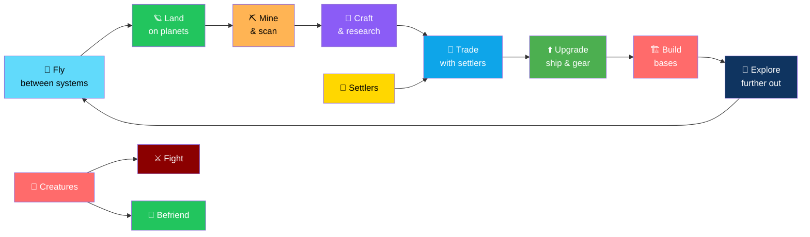
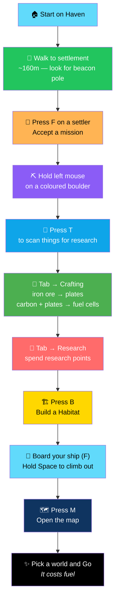

# 🚀 Space Explorer (Unreal Engine 5, C++)

<div align="center">


**Fly between 2,000 generated star systems. Land on planets. Build a life among the stars.**

*Mine · Scan · Trade · Research · Befriend · Fight · Build bases · Upgrade your ship*

[🎯 Overview](#-overview) • [⚙️ Setup](#-setup) • [🎮 First Ten Minutes](#-your-first-ten-minutes) • [🏗️ Architecture](#-architecture) • [⚠️ Status](#-status-and-honest-limitations)

</div>

---

## 📖 Overview

**Space Explorer** is an **open-world procedural galaxy adventure** built in **Unreal Engine 5 with C++**.

Fly between **2,000 generated star systems**, land on planets, mine and scan, fight or befriend creatures and settlers, trade, research, build bases, and upgrade your ship.

### Core Idea

> **All 14 build phases are implemented in code.**
>
> Art is placeholder — procedural primitives — but **the systems are real**. The galaxy is deterministic, the terrain streams, the economies run, the save system works.

### The Core Loop



---

## ⚙️ Requirements

| Requirement | Version |
|-------------|---------|
| **Unreal Engine** | 5.4+ — set `EngineAssociation` in `SpaceExplorer.uproject` for other 5.x |
| **Visual Studio 2022** | With **"Game development with C++"** *(Windows)* — or **Xcode** *(macOS)* |
| **Plugin** | `ProceduralMeshComponent` — ships with the engine, enabled in the `.uproject` |

---

## 🛠️ Setup

### 1. Generate Project Files

**Right-click `SpaceExplorer.uproject` → Generate Visual Studio project files.**

### 2. Build

1. Open the `.sln`
2. Set configuration to **Development Editor**
3. Build

### 3. Create the Level

1. Open the project
2. Create an **empty** level
3. Save it as **`Content/Maps/MainMap`**

> ⚠️ **Do NOT add a floor, lights, or a Player Start.**
>
> **The game mode builds the planet, sun, sky, and your ship.**

### 4. Play

**Press Play → Choose *New Game*.**

---

## 📦 Build / Package

### Editor

**Platforms → Windows → Package Project**

### Command Line

```bash
RunUAT BuildCookRun \
  -project=SpaceExplorer.uproject \
  -platform=Win64 \
  -clientconfig=Shipping \
  -build -cook -stage -pak -archive
```

---

## 🎮 Your First Ten Minutes



### Step by Step

1. **You start on Haven.** Walk to the settlement — about **160 m away**, look for the **beacon pole** — and press **F** on a settler.
2. **Accept a mission**, then **hold left mouse** on a coloured boulder to mine it. Press **T** to scan things for research.
3. **Tab → Crafting:** turn iron ore into plates, carbon + plates into fuel cells.
4. **Tab → Research:** spend research points on ship and survival upgrades.
5. **B** to build a **Habitat** *(breathable air + healing)* from iron plates and silicon.
6. **Board your ship (F)**, hold **Space** to climb out of the atmosphere, open the map **(M)**, pick a world and **Go**.
   > ⚠️ **It costs fuel.**

---

## 🏗️ Architecture

### System Overview

```mermaid
flowchart TB
    subgraph CORE["🧩 Core"]
        GameMode["game mode"]
        Controller["player controller<br/>UI state · actions · console"]
        Interfaces["interaction · scan interfaces"]
        Helpers["visual helpers"]
    end

    subgraph DATA["📦 Data"]
        Items["items"]
        Recipes["recipes"]
        Tech["tech tree"]
        Structures["structures"]
        Factions["factions"]
        Prices["price model"]
        Note["code-defined · no data assets"]
    end

    subgraph PROG["📈 Progression"]
        Credits["credits"]
        Research["research"]
        XP["XP"]
        Rep["reputation"]
        Disc["discoveries"]
        Missions["missions"]
        Settings["settings"]
        Saved["<em>one saved struct</em>"]
    end

    subgraph GALAXY["🌌 Galaxy"]
        Gen["deterministic galaxy<br/>star systems · planets · moons<br/>from a seed"]
        Travel["travel"]
    end

    subgraph WORLD["🪐 World"]
        Terrain["terrain chunks<br/>& streamer"]
        Populator["populator<br/>ore · ruins · settlements<br/>creatures · foliage"]
        Env["environment<br/>sun · sky · fog<br/>ocean · weather"]
        Base["base structures"]
    end

    subgraph PLAYER["👤 Player"]
        Char["character"]
        Vitals["vitals<br/>health · oxygen · energy"]
        Inv["stack inventory"]
    end

    subgraph SHIP["🚀 Ship"]
        Flight["6-DOF flight"]
        ShipSys["fuel · shields<br/>hull · cargo<br/>upgrades · cameras"]
    end

    subgraph LIFE["👥 Life"]
        Creatures["creatures<br/>animal AI"]
        NPC["NPC<br/>settler AI"]
        Walker["shared ASEWalker base"]
    end

    subgraph SAVE["💾 Save"]
        SaveSys["versioned slots · autosave<br/>planet-crossing loads<br/>travel snapshots"]
    end

    subgraph UI["🖥️ UI"]
        HUD["canvas HUD"]
        Menus["all menu screens"]
    end

    CORE --> DATA
    DATA --> PROG
    PROG --> GALAXY
    GALAXY --> WORLD
    WORLD --> PLAYER
    PLAYER --> SHIP
    SHIP --> LIFE
    LIFE --> SAVE
    SAVE --> UI

    style CORE fill:#61DAFB,color:#000
    style DATA fill:#22C55E,color:#fff
    style PROG fill:#8B5CF6,color:#fff
    style GALAXY fill:#FFB454,color:#000
    style WORLD fill:#0EA5E9,color:#fff
    style PLAYER fill:#FF6B6B,color:#fff
    style SHIP fill:#4CAF50,color:#fff
    style LIFE fill:#FFD700,color:#000
    style SAVE fill:#0f3460,color:#fff
    style UI fill:#000,color:#fff
```



### 🗂️ Folder Layout

| Folder | Contents |
|--------|----------|
| **`Core`** | Game mode · player controller *(UI state + actions + console)* · interaction/scan interfaces · visual helpers |
| **`Data`** | Items · recipes · tech tree · structures · factions · price model *(**code-defined, no data assets**)* |
| **`Progression`** | Credits · research · XP · reputation · discoveries · missions · settings — **one saved struct** |
| **`Galaxy`** | Deterministic galaxy — star systems, planets, moons from a seed · travel |
| **`World`** | Terrain chunks and streamer · populator *(ore, ruins, settlements, creatures, foliage)* · environment *(sun, sky, fog, ocean, weather)* · base structures |
| **`Player`, `Vitals`, `Inventory`** | Character · health/oxygen/energy · stack inventory |
| **`Ship`** | **6-DOF ship** with fuel, shields, hull, cargo, upgrades, cameras |
| **`Creatures`, `NPC`** | Animal AI and settler AI — **shared `ASEWalker` base** |
| **`SaveSystem`** | Versioned slots · autosave · planet-crossing loads · travel snapshots |
| **`UI`** | Canvas HUD and all menu screens |
| **`Tests`** | Automation tests |

### 🔧 Extending

<div align="center">

| To Add | Where |
|--------|-------|
| **Items · recipes · tech · structures** | `Data/SEGameData.cpp` |
| **Creature archetypes** | `SECreatureGen::Generate` |
| **Biomes** | `ESEBiome` plus `SETerrain::Height/Color` |

</div>

### Design Principles

<div align="center">

| Principle | Implementation |
|-----------|---------------|
| **🌌 Deterministic galaxy** | Star systems, planets, and moons are generated from a **seed** — the same seed always produces the same galaxy |
| **📦 Data is code-defined** | Items, recipes, tech, structures, factions, and prices live in `SEGameData.cpp` — no data assets to author |
| **💾 One saved struct** | All progression state serializes as a single struct — save/load is not scattered |
| **🚶 Shared walker base** | Creatures and settlers both derive from `ASEWalker` — one movement and animation foundation |
| **🌍 Streamed terrain** | Chunks load around the player — no giant pre-baked landscape |
| **🚀 Real ship physics** | 6-DOF flight with fuel, shields, hull, cargo, and upgrades |
| **🧪 Automation tests** | Galaxy determinism, terrain seams, inventory, vitals, missions, and species generation are all covered |
| **🚫 No fake features** | The **Status and Honest Limitations** section is the standard |

</div>

### 🗂️ Project Layout

```
SpaceExplorer/
├── SpaceExplorer.uproject
├── Config/
├── Content/
│   └── Maps/MainMap          ← you create this: empty, no floor/lights/PlayerStart
├── Source/
│   └── SpaceExplorer/
│       ├── Core/
│       ├── Data/
│       ├── Progression/
│       ├── Galaxy/
│       ├── World/
│       ├── Player/  Vitals/  Inventory/
│       ├── Ship/
│       ├── Creatures/  NPC/
│       ├── SaveSystem/
│       ├── UI/
│       └── Tests/
└── README.md
```

---

## 🧪 Tests

**Editor → Tools → Session Frontend → Automation** — filter **`SpaceExplorer`**.

### What's Covered

<div align="center">

| Area | Coverage |
|------|:--------:|
| **Galaxy determinism** | ✅ |
| **Terrain seams** | ✅ |
| **Inventory** | ✅ |
| **Vitals** | ✅ |
| **Missions** | ✅ |
| **Species generation** | ✅ |

</div>

---

## ⚠️ Status and Honest Limitations

> **This is what you should expect before your first build.**

<div align="center">

| Limitation | Details |
|-----------|---------|
| **🔴 Not compiled yet** | Written **without access to the Unreal compiler**. Expect a handful of compile errors on first build — typically a missing include or a changed API name. **Send them back and they are quick fixes** |
| **🎨 Procedural primitive art** | Cubes, spheres, cones. Terrain uses an **engine debug vertex-colour material** with lighting baked into vertex colours. **No audio, no animation.** Swap in meshes, materials, and sounds when you have assets |
| **🕳️ No caves** | Terrain is a **streamed heightfield** — ruins and settlements provide points of interest instead |
| **🌌 Jump travel, not seamless** | Planet-to-planet travel is a **hyperdrive jump with a level reload**, not a seamless atmosphere-to-orbit transition |
| **🛰️ Missing systems** | Space stations, asteroid-field gameplay, and a full creature encyclopedia UI beyond the Codex list are not implemented |
| **🖥️ Canvas HUD, not UMG** | The UI is a canvas HUD with mouse-clickable buttons |

</div>

> 💡 **We'd rather list what isn't there than ship a fake feature.**

---

## 🗺️ Roadmap

### ✅ Current — All 14 Build Phases

- [x] Core game mode and player controller
- [x] Interaction and scan interfaces
- [x] Code-defined data — items, recipes, tech tree, structures, factions, prices
- [x] Progression — credits, research, XP, reputation, discoveries, missions, settings
- [x] Single saved struct
- [x] Deterministic galaxy — star systems, planets, moons from a seed
- [x] Travel between systems
- [x] Streamed terrain chunks
- [x] Populator — ore, ruins, settlements, creatures, foliage
- [x] Environment — sun, sky, fog, ocean, weather
- [x] Base structures
- [x] Player character with health, oxygen, energy
- [x] Stack inventory
- [x] 6-DOF ship with fuel, shields, hull, cargo, upgrades, cameras
- [x] Creature AI
- [x] Settler AI
- [x] Shared `ASEWalker` base
- [x] Versioned save slots with autosave
- [x] Planet-crossing loads and travel snapshots
- [x] Canvas HUD and all menu screens
- [x] Automation tests — galaxy determinism, terrain seams, inventory, vitals, missions, species generation

### 🔜 Future Ideas

- [ ] **Compile it** — the first task is a successful build
- [ ] **Real art pipeline** — meshes, materials, animations
- [ ] **Audio** — music, ambience, SFX
- [ ] **Caves** — the heightfield limitation is intentional, but caves would add depth
- [ ] **Seamless atmosphere-to-orbit** — replace the level-reload jump
- [ ] **Space stations** — hubs and trading posts
- [ ] **Asteroid-field gameplay** — mining, hazards, piracy
- [ ] **Full creature encyclopedia UI** — beyond the Codex list
- [ ] **UMG UI** — migrate from canvas HUD
- [ ] **Mod support** — expose data tables as assets

---

## 🤝 Contributing

Contributions are welcome. Please:

1. Fork the repository
2. **Report compile errors you fix** — the project hasn't been built yet
3. **Keep data in `Data/SEGameData.cpp`** — items, recipes, tech, structures, factions, prices
4. **Keep progression in one struct** — save/load is the contract
5. **Add automation tests for any new system** — the `SpaceExplorer` filter is the suite
6. **Never fake a feature** — the **Status and Honest Limitations** section is the standard
7. Submit a Pull Request

### Guidelines

- **Never claim it compiles** without a build log
- **Never claim it's playable** without a playtest
- **Never remove an honest limitation** without actually implementing the feature
- **Never hard-code content that belongs in `SEGameData.cpp`**
- **Never break save compatibility** without a migration path

---

## 📜 License

MIT — see [LICENSE](LICENSE) for details.

---

## 🙏 Acknowledgments

- **Unreal Engine 5** — for making procedural worlds at this scale possible
- **`ProceduralMeshComponent`** — for the terrain and shapes
- **Every space game that ever made you want to see what's over the next horizon** — this one's for you

---

<div align="center">

### 🚀 FLY. LAND. MINE. BUILD. EXPLORE.

**2,000 star systems. One seed. All systems implemented.**

**Art is placeholder. The galaxy is real.**

<br>

> ⚠️ **Not compiled yet — expect a handful of first-build fixes.**

<br>

⭐ If this project helped you, consider giving it a star.

<br>

[⬆ Back to Top](#-space-explorer-unreal-engine-5-c)

</div>
